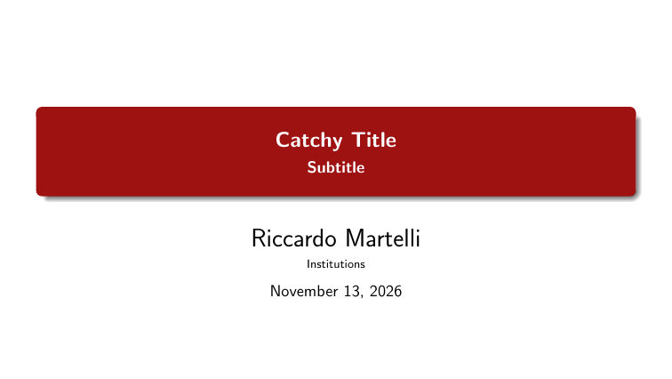
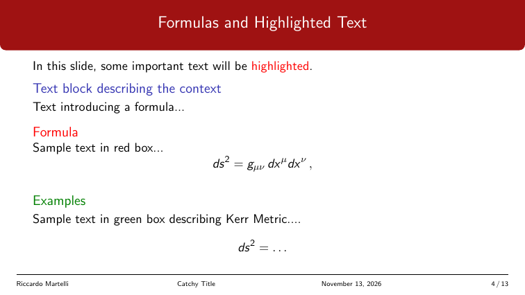

<h1 align="center">NovaBeamer Theme</h1>

<h3 align="center">A clean LaTeX Beamer theme for academic and scientific presentations.</h3>

<p align="center">
  <a href="https://ctan.org/pkg/novabeamer-theme">
    
  </a>
  <a href="./LICENSE">
    
  </a>
  
  
  <a href="https://github.com/Riccardo-Martelli/NovaBeamer-Theme/stargazers">
    
  </a>
  <a href="https://github.com/Riccardo-Martelli/NovaBeamer-Theme/network/members">
    
  </a>
</p>


<p align="center">
  
  
</p>

* **Standard Beamer integration:** loads with the native `\usetheme` command.
* **Customizable colors:** one theme color, redefinable in your preamble to match your institution.
* **Clean layout:** rounded title boxes, full-width frame titles and a minimal footline with author, title, date and frame number.
* **Title page:** title and subtitle in a colored box, with support for `\titlegraphic`.


## Contents

* [Requirements](#requirements)
* [Compatibility](#compatibility)
* [Installation](#installation)
* [Usage](#usage)
  * [Version 1.0 and Overleaf](#version-10-and-overleaf)
* [Customization](#customization)
* [Example and documentation](#example-and-documentation)
* [Changelog](#changelog)
* [Maintainer](#maintainer)
* [License](#license)


## Requirements

* A LaTeX distribution with the `beamer` class
* The `tikz` and `comment` packages (loaded by the theme)
* A LaTeX kernel from October 2020 or later


## Compatibility

| Distribution | Status |
|---|---|
| TeX Live | included as `novabeamer-theme` |
| MiKTeX | included as `novabeamer-theme` |
| Overleaf | included through TeX Live; as of November 2026 it ships version 1.0, see [Version 1.0 and Overleaf](#version-10-and-overleaf) |
| Local copy | put `beamerthemenovabeamer.sty` next to your `.tex` file |


## Installation

The theme is part of TeX Live and MiKTeX, so an up to date distribution already has it. To use the version in this repository instead:

```bash
git clone https://github.com/Riccardo-Martelli/NovaBeamer-Theme.git
```

Then either copy `beamerthemenovabeamer.sty` into the folder of your presentation, or place it in your local TeX tree and refresh the filename database:

```bash
texhash
```


## Usage

```latex
\documentclass{beamer}
\usetheme{novabeamer}

\title{Sample Presentation}
\author{Your Name}
\institute{Your Institution}
\date{\today}

\begin{document}

\frame{\titlepage}

\begin{frame}{Introduction}
Welcome to this presentation using the NovaBeamer Theme.
\end{frame}

\end{document}
```

### Version 1.0 and Overleaf

Version 1.0 shipped the file as `novabeamer.sty`, loaded with `\usepackage{novabeamer}`. Version 1.1 renamed it to `beamerthemenovabeamer.sty` so that `\usetheme` works. If your distribution still provides version 1.0 (Overleaf did as of November 2026), use `\usepackage{novabeamer}`, or load whichever file is available:

```latex
\IfFileExists{beamerthemenovabeamer.sty}{\usetheme{novabeamer}}{\usepackage{novabeamer}}
```


## Customization

The theme color is `sithred`. Redefine it after `\usetheme` to change the title box, the section frames and the frame titles at once:

```latex
\usetheme{novabeamer}
\definecolor{sithred}{RGB}{0,70,140}
```

Frame titles and the footline are standard Beamer templates, so `\setbeamertemplate` and `\setbeamercolor` override them as usual.


## Example and documentation

* `examples/novabeamer-example.tex`: a full presentation with sections, blocks, columns, a table, a theorem, a figure and a bibliography. Compile it from the repository root, with a `bibtex` pass for the references.
* `doc/novabeamer-doc.pdf`: installation, usage and customization guide.


## Changelog

* **1.1**: renamed the main file to `beamerthemenovabeamer.sty` to support the standard `\usetheme` mechanism.
* **1.0**: first release on CTAN (Comprehensive TeX Archive Network), April 2025.


## Maintainer

<a href="https://github.com/Riccardo-Martelli">
  
</a>

**Riccardo Martelli**: [GitHub](https://github.com/Riccardo-Martelli) | [LinkedIn](https://www.linkedin.com/in/riccardomartelli/) | [Webpage](https://riccardo-martelli.github.io/.github.io/index.html) | [CTAN](https://ctan.org/pkg/novabeamer-theme)


## License

This work is released under the LaTeX Project Public License (LPPL) 1.3c. [View License](LICENSE)
